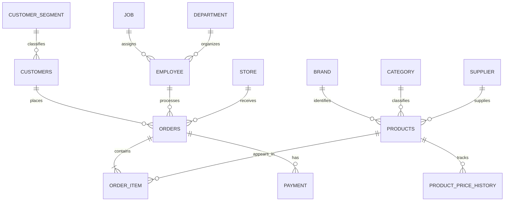

# NovaMart OLTP Database Design

## 1. Overview

The NovaMart Online Transaction Processing (OLTP) database was designed in PostgreSQL to support the operational activities of a retail e-commerce business.

The database stores information about customers, products, suppliers, employees, stores, orders, order items, payments, and product price history.

The OLTP database serves as the source system for the downstream data warehouse.

## 2. Database Tables

The database consists of 14 operational tables grouped into the following business areas.

| Business Area | Tables |
|---|---|
| Customer Management | `customers`, `customer_segment` |
| Product Management | `products`, `brand`, `category`, `supplier`, `product_price_history` |
| Employee Management | `employee`, `job`, `department` |
| Sales Operations | `store`, `orders`, `order_item`, `payment` |

## 3. Entity Relationships

The database uses primary keys to uniquely identify records and foreign keys to establish relationships between related tables.

### Relationship Summary

| Parent Table | Child Table | Relationship |
|---|---|---|
| customer_segment | customers | One-to-many |
| brand | products | One-to-many |
| category | products | One-to-many |
| supplier | products | One-to-many |
| job | employee | One-to-many |
| department | employee | One-to-many |
| customers | orders | One-to-many |
| employee | orders | One-to-many |
| store | orders | One-to-many |
| orders | order_item | One-to-many |
| products | order_item | One-to-many |
| orders | payment | One-to-many |
| products | product_price_history | One-to-many |

### Entity Relationship Diagram

The following diagram represents the logical relationships between the operational tables.

## 4. Primary and Foreign Keys

Each operational table has a primary key that uniquely identifies its records.

Foreign keys enforce referential relationships between the tables. Examples include:

- `orders.customer_id` references `customers.customer_id`.
- `order_item.order_id` references `orders.order_id`.
- `order_item.product_id` references `products.product_id`.
- `payment.order_id` references `orders.order_id`.
- `product_price_history.product_id` references `products.product_id`.

## 5. Data Integrity Constraints

The database uses PostgreSQL constraints to enforce important business rules.

Examples include:

- Customer email and phone numbers are unique when provided.
- Product prices and costs are stored using decimal data types.
- Order item quantities must be greater than zero.
- Payment amounts must be greater than zero.
- Payment methods are restricted to Cash, Card, and Bank Transfer.
- Payment statuses are restricted to Pending, Completed, Failed, and Refunded.
- Order statuses are restricted to Pending, Processing, Shipped, Delivered, and Cancelled.
- Product price-history records enforce valid effective dates and status combinations.

## 6. Product Price History

The `product_price_history` table maintains historical product pricing information.

It contains:

- `price_history_id`: Primary key.
- `product_id`: Reference to the product.
- `unit_price`: Recorded product price.
- `effective_from`: Date the price becomes effective.
- `effective_to`: Date the price stops being effective.
- `effective_status`: Indicates whether the record is active or historical.

The database enforces the following rules:

- An active price record (`Y`) must have a NULL `effective_to`.
- A historical price record (`N`) must have a non-NULL `effective_to`.
- The ending date cannot precede the starting date.

## 7. Order and Payment Design

The `orders` table stores order-level information, while `order_item` stores the individual product lines belonging to each order.

This separation allows one order to contain multiple products and quantities.

The `payment` table is also separate from `orders`. One order can have multiple payment records, allowing the database to retain individual payment attempts and their statuses.

## 8. Database Technology

| Component | Technology |
|---|---|
| Database | PostgreSQL |
| Query Language | SQL |
| Database Design | Relational OLTP |
| Integrity | Primary keys, foreign keys, UNIQUE, CHECK and NOT NULL constraints |

## 9. Role in the Data Warehouse Project

The OLTP database is the source layer of the NovaMart data warehouse project.

Its operational data is used as the input for data quality auditing, ETL development, dimensional modelling, warehouse loading, and post-load validation.

The warehouse is designed separately to support analytical queries without changing the purpose of the operational database.
