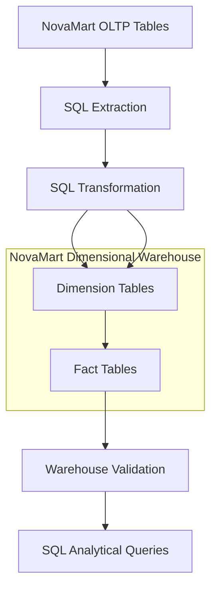

# NovaMart Data Warehouse Architecture

## 1. Overview

Following the OLTP database design, data-quality auditing, and remediation investigation, the next stage of the NovaMart project involved designing and implementing a dimensional data warehouse.

The purpose of the warehouse was to transform operational data into a structured analytical model that supports consistent querying across customers, products, employees, stores, sales, payments, and product price history.

The warehouse was implemented in PostgreSQL within the same database as the existing OLTP tables. Separate dimension and fact tables were created to provide an analytical structure without replacing the operational database.

## 2. Architecture Design

The NovaMart warehouse follows a dimensional modelling approach consisting of:

- Operational source tables (OLTP).
- Dimension tables.
- Fact tables.
- SQL-based extraction, transformation, and loading (ETL).

The OLTP tables serve as the source of operational records. SQL transformations were used to populate the warehouse dimensions and facts.

The architecture separates descriptive business attributes from measurable business events.

## 3. High-Level Data Flow

The overall data flow follows this structure:

The source operational tables provide the records used to populate the dimensional warehouse.

SQL transformations prepare the source data for insertion into the appropriate dimension and fact tables. The resulting warehouse is then subjected to validation checks before analytical queries are performed.

## 4. Dimension Tables

Six dimension tables were implemented.

| Dimension | Purpose |
|---|---|
| `dim_customer` | Stores customer descriptive attributes and customer history. |
| `dim_supplier` | Stores supplier information and supplier history. |
| `dim_employee` | Stores employee attributes and employment-related history. |
| `dim_store` | Stores store information and store history. |
| `dim_product` | Stores product attributes, pricing information, and product history. |
| `dim_date` | Provides calendar attributes for analysing business events by date. |

### Slowly Changing Dimension Type 2

SCD Type 2 was implemented for five dimensions:

- `dim_customer`
- `dim_supplier`
- `dim_employee`
- `dim_store`
- `dim_product`

The implementation uses:

- Surrogate keys to identify dimension records.
- `valid_from` to record the beginning of a version's validity.
- `valid_to` to record the end of a version's validity.
- `is_current` to identify the current version.

The design also includes constraints and indexes to protect historical validity, prevent overlapping validity periods, and enforce one current version per business key.

The `dim_date` table is a calendar dimension and does not use SCD Type 2.

## 5. Fact Tables

Three fact tables were implemented.

| Fact table | Grain | Purpose |
|---|---|---|
| `fact_sales` | One row per order item | Records sales transactions and their associated measures. |
| `fact_payment` | One row per payment record | Records payment transactions and their statuses. |
| `fact_product_pricehistory` | One row per product price-history record | Records historical product prices and their effective periods. |

### Fact Sales

`fact_sales` captures sales transaction details, including:

- Quantity
- Unit price
- Discount amount
- Sales amount

The sales amount is calculated using:

`(quantity × unit_price) - COALESCE(discount_amount, 0)`

The table uses `order_item_id` as a unique source identifier to enforce its selected grain.

### Fact Payment

`fact_payment` records individual payment transactions.

It includes payment amount, payment method, and payment status. The table preserves the different payment statuses rather than treating every payment record as a completed collection.

### Fact Product Price History

`fact_product_pricehistory` records product price-history events, including:

- Product reference
- Effective start date
- Effective end date
- Unit price
- Effective status

This table supports the analysis of historical product pricing over time.

## 6. Dimension and Fact Relationships

The fact tables reference their relevant dimensions through surrogate keys.

The relationships are:

- `fact_sales` → `dim_customer`, `dim_product`, `dim_employee`, `dim_store`, and `dim_date`.
- `fact_payment` → `dim_customer`, `dim_employee`, `dim_store`, and `dim_date`.
- `fact_product_pricehistory` → `dim_product` and `dim_date`.

The `dim_product` table also contains a `supplier_key` relationship to `dim_supplier`.

The date dimension is shared across fact tables that require date-based analysis. This makes `dim_date` a conformed dimension.

## 7. Implementation Environment

The warehouse was implemented using:

- **Database:** PostgreSQL
- **Database management interface:** pgAdmin 4
- **Query language:** SQL
- **Modelling approach:** Dimensional modelling
- **Historical tracking:** Slowly Changing Dimension Type 2

The OLTP and dimensional warehouse tables were created within the same PostgreSQL database.

The ETL transformations were implemented using SQL statements rather than a separate ETL platform.

## 8. Architecture and Data Integrity Considerations

The warehouse design incorporated several data-integrity considerations:

1. Surrogate keys were used to identify dimension and fact records.
2. Foreign keys were used to enforce relationships between fact and dimension tables.
3. SCD Type 2 constraints were used to maintain historical version consistency.
4. Date keys linked business events to the calendar dimension.
5. Fact-table grain was explicitly defined and enforced using unique source identifiers where applicable.
6. Historical product price records were preserved as separate fact records.

These design decisions established the structural foundation for subsequent ETL implementation and warehouse validation.

## 9. Conclusion

The NovaMart dimensional warehouse provides an analytical structure built from the operational OLTP database.

By separating descriptive dimensions from transactional facts, the design supports consistent analysis across different business areas.

The implementation also incorporates historical tracking through SCD Type 2, shared calendar attributes through `dim_date`, and referential integrity between fact and dimension tables.

This architecture established the foundation for the SQL-based ETL process and subsequent warehouse validation.
